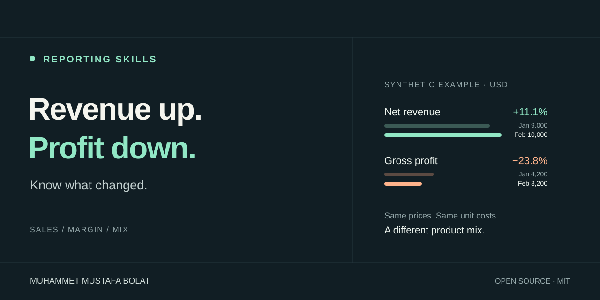

<p align="center"></p>

<p align="center"><a href="#get-started">Get started</a> · <a href="#see-it-work">See it work</a> · <a href="docs/EXAMPLES.md">Examples</a> · <a href="CONTRIBUTING.md">Contribute</a></p>

<p align="center"><a href="LICENSE"></a>  <a href="https://github.com/bymmb/reporting-skills/actions/workflows/checks.yml"></a></p>

# Reporting Skills

**Turn sales data into a management report you can trace back to the numbers.**

A reusable agent skill for sales and profitability reporting. Define the metrics, compare like-for-like periods, reconcile totals, and explain the arithmetic behind performance changes.

## Get started

```bash
npx skills add bymmb/reporting-skills --skill reporting
```

The installer runs on Node.js (Skills CLI 1.7.4 requires Node.js 22.20 or later; see the [Skills CLI documentation](https://github.com/vercel-labs/skills) for current requirements). Without Node.js, download `reporting-v0.1.0.zip` from the [latest release](https://github.com/bymmb/reporting-skills/releases/latest) and unzip the `reporting` folder into your agent's skill directory. The bundled engine needs Python 3.10 or later. This project does not require an additional API key; your chosen agent has its own requirements.

> Prepare a monthly sales and gross-profit report from this file. Reconcile the totals, explain the largest changes, and distinguish supported findings from hypotheses.

The package follows the Agent Skills format. Agent-specific installation and runtime behavior should be verified in your environment.

## See it work

The included synthetic dataset demonstrates a common reporting trap:

| Metric (USD) | January | February | Change |
|---|---:|---:|---:|
| Net revenue | 9,000 | 10,000 | +11.1% |
| Gross profit | 4,200 | 3,200 | −23.8% |
| Gross margin | 46.7% | 32.0% | −14.7 pp |

**Unit prices and unit costs stayed the same.** Sales shifted toward the lower-margin Basic product. Under the documented decomposition order, volume contributes +2,520 USD and mix contributes −3,520 USD: net gross-profit movement is −1,000 USD.

From the repository root:

```bash
python skills/reporting/scripts/analyze_sales.py --input skills/reporting/assets/sales.example.csv --config skills/reporting/assets/contract.example.json --out output/analysis.json
python skills/reporting/scripts/check_examples.py
```

Excerpt from `output/analysis.json` produced by the first command:

```json
"status": "computed",
"profit_bridge": {
  "components": {
    "volume": "2520", "mix": "-3520.00", "price": "0", "unit_cost": "0",
    "entrants": "0", "exits": "0", "other_adjustments": "0"
  },
  "gross_profit_change": "-1000",
  "residual": "0.00",
  "reconciled": true
}
```

The engine uses Python's standard library and preserves decimal precision. Read the [engine contract](skills/reporting/references/engine-contract.md) before adapting it to your data.

## Built for useful decisions

- Define net revenue, COGS, gross profit, currency, row grain, and cutoff.
- Compare equivalent periods and keep currencies separate.
- Reconcile product contributions and arithmetic bridge components.
- Handle zero/negative baselines and malformed records explicitly.
- Separate numerical contributions from untested business hypotheses.

## Scope

The skill can work through host spreadsheet, SQL, or calculation tools. The bundled engine accepts normalized CSV and an explicit JSON contract. It does not calculate net profit without expense data, convert currencies, establish source completeness, or prove causation. XLSX and document output depend on host tools.

Acceptance cases are included for reproducible checks. Cross-agent compatibility and comparative model performance have not been benchmarked in this release.

## Contribute

[Open an issue](https://github.com/bymmb/reporting-skills/issues) with a small synthetic example, expected behavior, and actual output. See [contributing](CONTRIBUTING.md).

If this saves you time, a star helps others find it.

---

Created and maintained by **Muhammet Mustafa Bolat** · [BYMMB](https://bymmb.com) · [Bilengo](https://bilengo.com)

[MIT license](LICENSE) · Also explore [Skill Doctor](https://github.com/bymmb/skill-doctor).
